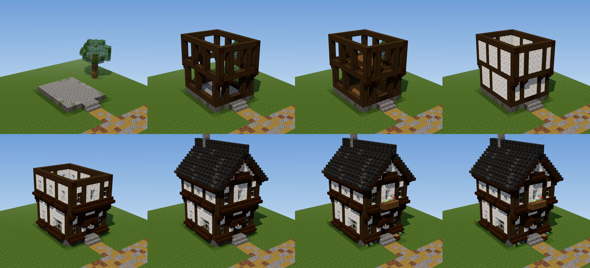

# Example: Vale town house (test building, 2026-11-11)

The first building made by following these instructions stage by stage. `test_house.py` builds it, one
function per stage, and renders each stage with real Bedrock textures. It uses the kit in
`map/structures/` (bp.py, kit.py, render/), so run it from that folder on a branch that has the kit.

    python3 test_house.py OUT --textures <bedrock-samples>/resource_pack/textures/blocks --three <node_modules/three>

## Plan (stage 0)

| Field | Value |
|---|---|
| Type, region, town | town house, Vale (plaster and timber style), Kingsrest |
| Footprint | 9 x 11 (x 0..8, z 0..10), front south |
| Storeys | 2, storey height 5 (9 wide), floor to floor 6 |
| Heights | ground outside y 0, plinth y 1, ground floor walking y 2, upper floor layer y 7, wall plate y 12, ridge y 17 |
| Jetty | upper storey 1 out front and back (z -1..11 = 13 deep, so the sides stay odd) |
| Bay patterns | front `P1P3P1P` (both storeys), back `P3P3P`, ground sides `P3P5P`, upper sides `P3P3P3P` |
| Door | centre of the front (x 4), door bay x 3..5, lintel beam, canopy with brackets and one hanging lantern; one rise: a landing block and a stair, 3 wide |
| Windows | ground: front x 1, 7; back x 2, 6 (shutters); sides z 2 and 3-wide z 6..8. Upper: front x 1, 4, 7 (planter under x 4); back x 2, 6; sides z 1, 5, 9; gable windows on the centre line. 2 of 18 windows have shutters |
| Glass | `brown_stained_glass_pane` (plaster house, `palettes/vale.md`) |
| Floors | spruce top slabs, dark oak border, joists every 3, stair along the east wall (6 steps), rail round the well |
| Roof | gable, ridge along z, pitch 1, overhang 1, verge 1, slate (Kingsrest's majority colour), barge boards and eave row, chimney through the ridge |
| Interior | empty: floors, stair, two trusses (the upper rooms are open to the roof), hung lanterns |

## What the test changed in the instructions

- Jetties come in pairs so the walls they lengthen stay odd (`02-frame`).
- No cap on timber windows with a beam 2 or fewer blocks above (`05-windows-and-doors`).
- On narrow timber fronts the door bay's infill can be the jambs; timber fronts read as at least half
  infill (`04-walls`, `05-windows-and-doors`).
- The wall plate is the gable's bottom beam, no second beam on it (`06-roof`).
